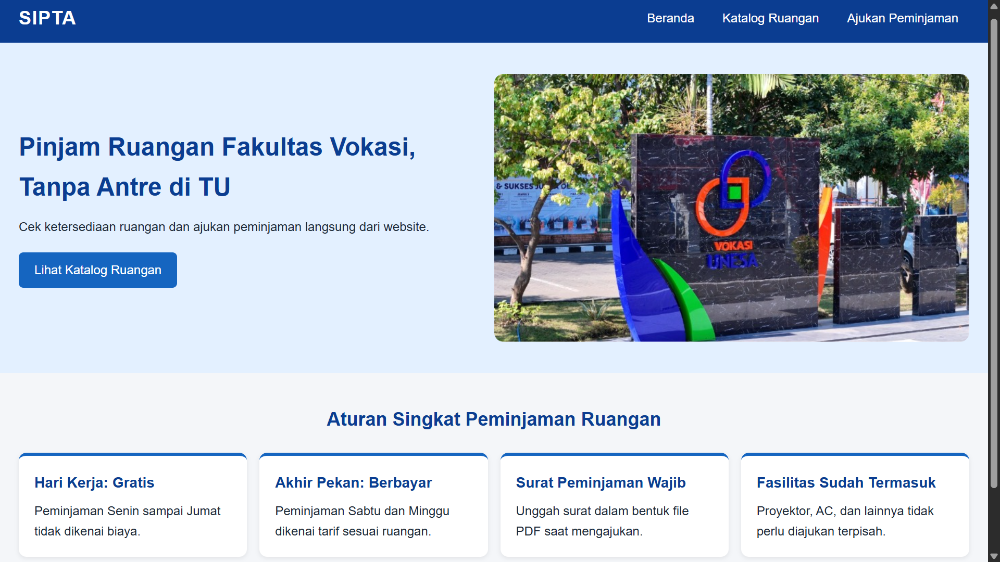
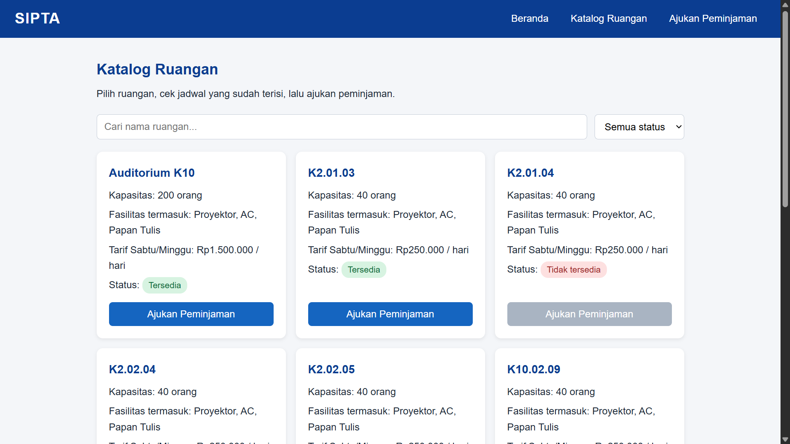
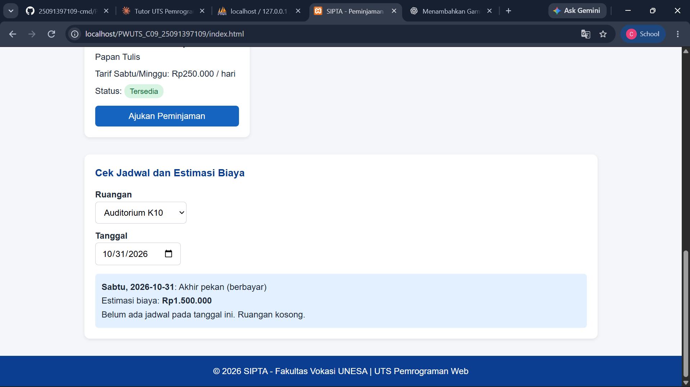
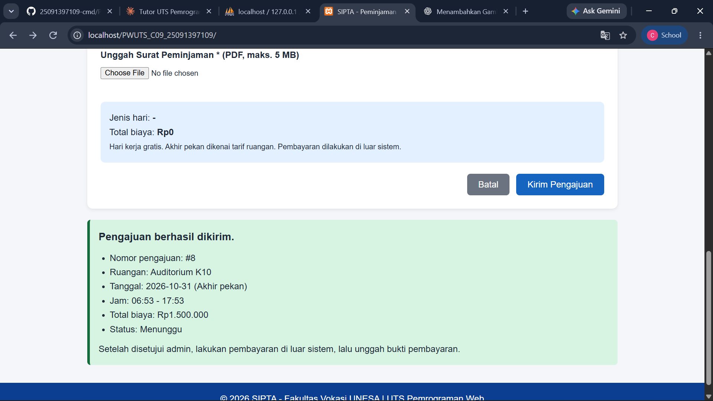
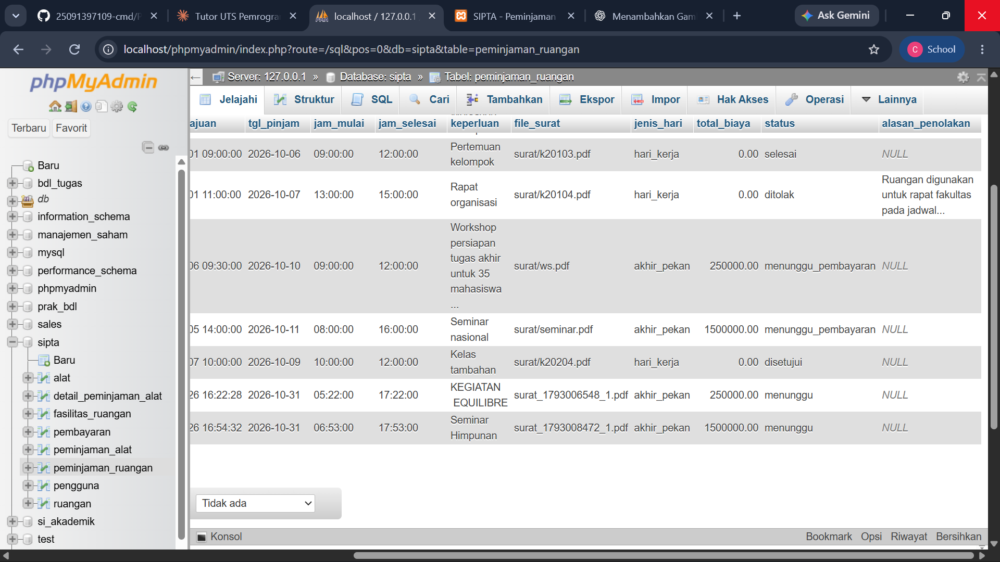

# SIPTA: Peminjaman Ruangan Fakultas Vokasi UNESA

Dokumentasi pengerjaan **UTS Pemrograman Web** (Semester Gasal 2026/2027).

| | |
|---|---|
| **Nama** | Carissa Amanda E Pohan |
| **NIM** | 25091397109 |
| **Kelas** | D4 Manajemen Informatika 2025C |
| **Kelompok** | SIPTA (kode kelompok: C09) |
| **Dosen** | Ari Kurniawan, S.Kom, M.T. |
| **Bagian yang saya kerjakan** | **Peminjaman Ruangan** |
| **Repository** | https://github.com/25091397109-cmd/PWUTS_C09_25091397109 |
| **Link Website (lokal)** | [Buka Website SIPTA](http://localhost/PWUTS_C09_25091397109/index.html) |

---

## 1. Deskripsi Singkat

SIPTA (Sistem Peminjaman dan Sewa Alat dan Ruangan) adalah website untuk mempermudah mahasiswa Fakultas Vokasi UNESA meminjam fasilitas tanpa harus datang langsung ke Tata Usaha. Topik dan fitur mengacu pada **proposal kelompok SIPTA**.

Untuk UTS ini saya mengerjakan bagian **Peminjaman Ruangan**, yaitu:

- melihat daftar ruangan beserta kapasitas, fasilitas, tarif, dan status,
- mengecek jadwal ruangan dan estimasi biaya,
- mengajukan peminjaman ruangan lewat form (dengan surat peminjaman berformat PDF).

**Tujuan:** mahasiswa dapat mengecek ketersediaan ruangan dan mengajukan peminjaman secara daring, dengan biaya yang dihitung otomatis dan jadwal yang tidak bentrok.

Sesuai pembagian tugas kelompok, bagian 2.a, 2.b, dan 2.c pada UTS ini berbeda dengan anggota kelompok lain.

---

## 2. Ketentuan UTS dan Wujudnya di Project

| Ketentuan UTS | Wujud di project | File |
|---|---|---|
| 2.a Homepage sebagai layout utama, responsive, HTML + CSS + JS/jQuery | Halaman utama dengan navbar, hero bergambar, kartu aturan, dan footer. Responsive dengan media query | `index.html`, `css/style.css` |
| 2.a Menu memakai teknik AJAX | Menu **Katalog Ruangan** dan **Ajukan Peminjaman** memuat halaman ke `<main id="konten">` tanpa reload (jQuery `.load()`) | `js/script.js` |
| 2.b Halaman konten + interaksi/simulasi JS | **Katalog Ruangan**: data dari database, cari, filter status, cek jadwal, dan estimasi biaya | `pages/katalog.html` |
| 2.c Halaman form transaksi + validasi JS sebelum submit ke server HTTP | **Form Pengajuan Peminjaman Ruangan** dengan validasi JS/jQuery, lalu dikirim ke server dengan AJAX POST | `pages/form.html`, `php/proses_peminjaman.php` |
| 2.b dan 2.c bagian dari layout utama | Kedua halaman hanya berisi potongan konten dan dimuat ke `#konten` pada `index.html` | `pages/*.html` |
| 2.e Dokumentasi | File ini | `README.md` |
| 3.b Folder GitHub `PWUTS_<kode_kelompok>_<nim>` | `PWUTS_C09_25091397109` | (repository) |

---

## 3. Fitur

1. **Homepage**: pengantar SIPTA dan empat aturan singkat peminjaman ruangan (hari kerja gratis, akhir pekan berbayar, surat wajib, fasilitas sudah termasuk).
2. **Katalog Ruangan** (data diambil dari database):
   - kartu ruangan: nama, kapasitas, fasilitas yang termasuk, tarif akhir pekan, dan status,
   - kotak **cari** nama ruangan dan **filter** status,
   - **Cek Jadwal dan Estimasi Biaya**: pilih ruangan dan tanggal, lalu tampil jenis hari, estimasi biaya, dan jam yang sudah terisi,
   - tombol **Ajukan Peminjaman** (nonaktif untuk ruangan yang tidak tersedia). Saat diklik, form terbuka dengan ruangan sudah terpilih.
3. **Form Pengajuan Peminjaman Ruangan**:
   - pilihan ruangan (ruangan tidak tersedia tidak bisa dipilih),
   - **kotak biaya otomatis** (jenis hari dan total biaya langsung berubah saat ruangan atau tanggal dipilih),
   - **validasi langsung** per kolom saat mengisi dan saat tombol kirim ditekan,
   - kirim ke server dengan AJAX, lalu tampil ringkasan pengajuan dengan status **Menunggu**.

---

## 4. Teknologi

| Bagian | Teknologi |
|---|---|
| Tampilan | HTML5, CSS3 (flexbox, grid, media query) |
| Interaksi | JavaScript dan jQuery 3.7.1 (via CDN) |
| Komunikasi tanpa reload | AJAX (`.load()`, `$.getJSON()`, `$.ajax()`) |
| Server | PHP (mysqli, prepared statement) |
| Database | MySQL |
| Web server lokal | XAMPP (Apache + MySQL) |
| Editor | Visual Studio Code |

Teknologi PHP dan MySQL mengikuti daftar perangkat lunak pada proposal (proposal menyebut Laragon, saya memakai XAMPP yang fungsinya sama).

---

## 5. Struktur Folder

```
PWUTS_C09_25091397109/
├── index.html                    Layout utama (homepage)
├── css/
│   └── style.css                 Seluruh tampilan + responsive
├── js/
│   └── script.js                 Navigasi AJAX, katalog, cek jadwal, kotak biaya, validasi, kirim form
├── pages/
│   ├── katalog.html              Halaman konten (2.b)
│   └── form.html                 Halaman form (2.c)
├── php/
│   ├── koneksi.php               Sambungan ke MySQL
│   ├── get_ruangan.php           Daftar ruangan + fasilitas (JSON)
│   ├── get_jadwal.php            Jadwal terisi per ruangan dan tanggal (JSON)
│   └── proses_peminjaman.php     Menerima form, validasi server, simpan ke database
├── database/
│   └── sipta.sql                 Struktur tabel + data contoh
├── uploads/                      Tempat surat PDF yang diunggah
├── images/
│   └── ruang-hero.jpeg           Gambar hero homepage
├── screenshots/                  Gambar bukti untuk dokumentasi ini
└── README.md
```

---

## 6. Cara Menjalankan

Project ini memakai PHP dan MySQL, jadi harus dijalankan lewat web server lokal (**tidak bisa** dengan klik dua kali `index.html`, karena AJAX diblokir browser).

1. Pasang **XAMPP**, lalu jalankan **Apache** dan **MySQL** di XAMPP Control Panel.
2. Salin folder `PWUTS_C09_25091397109` ke `C:\xampp\htdocs\`.
3. Buka `http://localhost/phpmyadmin`, klik tab **Import**, pilih `database/sipta.sql`, lalu klik **Import**. Database bernama **`sipta`** akan terbentuk.
4. Pastikan folder `uploads/` ada di dalam folder project.
5. (Jika perlu) Sesuaikan akun MySQL di `php/koneksi.php`. Bawaan XAMPP: user `root`, tanpa password, database `sipta`.
6. Buka di browser:

   ```
   http://localhost/PWUTS_C09_25091397109/
   ```

---

## 7. Penjelasan Fitur Peminjaman Ruangan

### 7.1 Alur penggunaan

1. Pengguna membuka homepage, lalu klik menu **Katalog Ruangan**.
2. Pengguna melihat kartu ruangan, boleh mencari atau memfilter, dan mengecek jadwal.
3. Pengguna klik **Ajukan Peminjaman**, dan form terbuka dengan ruangan sudah terpilih.
4. Pengguna mengisi tanggal, jam mulai, jam selesai, keperluan, dan mengunggah surat PDF.
5. JavaScript memeriksa isian. Jika ada yang salah, pesan error tampil dan form tidak dikirim.
6. Jika valid, data dikirim ke `proses_peminjaman.php`. Server memeriksa ulang, menghitung jenis hari dan biaya, mengecek bentrok, menyimpan surat, lalu menyimpan ke database dengan status **menunggu**.
7. Ringkasan pengajuan tampil di halaman yang sama.

### 7.2 Aturan yang diambil dari proposal

| Aturan | Sumber proposal | Penerapan |
|---|---|---|
| Hari kerja (Senin sampai Jumat) gratis, akhir pekan (Sabtu dan Minggu) berbayar | Batasan Masalah 1.2.4, kebutuhan fungsional 2.1 | PHP menentukan `jenis_hari` dari tanggal, `total_biaya` = Rp0 atau tarif ruangan |
| Surat peminjaman wajib dan formatnya divalidasi | 2.1 | Wajib PDF, maksimal 5 MB (batas 5 MB mengikuti wireframe) |
| Jadwal ruangan tidak boleh bentrok | 2.1, 2.2 (Reliability) | Query pengecekan jam tumpang tindih |
| Fasilitas ruangan sudah termasuk, tidak diajukan terpisah | 1.2.4 | Fasilitas hanya ditampilkan di kartu |
| Pengajuan baru berstatus "Menunggu" | 2.1 | `status = 'menunggu'` |
| Tidak menyimpan transaksi ganda | 2.2 (Reliability) | Tombol kirim dinonaktifkan selama proses |

### 7.3 Tabel database yang dipakai

Database `sipta` berisi seluruh tabel proposal, tetapi fitur saya memakai empat tabel berikut (nama tabel, kolom, dan tipe data mengikuti proposal bab 3.1):

| Tabel | Dipakai untuk |
|---|---|
| `ruangan` | Daftar ruangan di katalog (kapasitas, `tarif_akhir_pekan`, `status`) |
| `fasilitas_ruangan` | Fasilitas per ruangan (relasi 1:N ke `ruangan`) |
| `peminjaman_ruangan` | Menyimpan pengajuan dari form |
| `pengguna` | Pemilik pengajuan (`id_pengguna`) dan admin pemroses (`id_admin`) |

### 7.4 Isian form dan kolom database

| Isian di form | Kolom `peminjaman_ruangan` |
|---|---|
| Ruangan | `id_ruangan` |
| Tanggal Pinjam | `tgl_pinjam` |
| Jam Mulai | `jam_mulai` |
| Jam Selesai | `jam_selesai` |
| Keperluan Kegiatan | `keperluan` |
| Surat Peminjaman (PDF) | `file_surat` (nama file di folder `uploads/`) |

Kolom yang **diisi otomatis** (bukan isian pengguna): `id_pengguna`, `tgl_pengajuan` (`NOW()`), `jenis_hari`, `total_biaya`, dan `status` (`menunggu`). Kolom `id_admin` dan `alasan_penolakan` dibiarkan kosong (NULL) sampai admin memproses pengajuan.

---

## 8. Validasi Form

Validasi dilakukan **dua lapis**: JavaScript/jQuery di browser (sebelum dikirim, sesuai ketentuan UTS 2.c) dan PHP di server (jaga-jaga jika validasi browser dilewati).

### 8.1 Validasi JavaScript/jQuery (`js/script.js`)

| Jika kondisi ini terjadi | Maka website... |
|---|---|
| Ruangan belum dipilih | Tampil "Ruangan wajib dipilih." |
| Tanggal kosong | Tampil "Tanggal wajib diisi." |
| Tanggal sebelum hari ini | Tampil "Tanggal tidak boleh sebelum hari ini." (kalender juga menutup tanggal lampau) |
| Jam mulai kosong | Tampil "Jam mulai wajib diisi." |
| Jam selesai kosong | Tampil "Jam selesai wajib diisi." |
| Jam selesai sama atau sebelum jam mulai | Tampil "Jam selesai harus setelah jam mulai." |
| Keperluan kurang dari 10 karakter | Tampil "Keperluan minimal 10 karakter (baru n)." |
| Surat belum dipilih | Tampil "Surat peminjaman wajib diunggah." |
| Surat bukan PDF | Tampil "File harus berformat PDF." |
| Surat lebih dari 5 MB | Tampil "Ukuran file maksimal 5 MB." |
| Semua kolom benar | Kolom bertanda hijau, form dikirim ke server |

Validasi berjalan **langsung** (saat nilai berubah, saat kolom ditinggalkan, dan saat mengetik di Keperluan), tidak hanya saat tombol kirim ditekan. Jika ada kolom salah, form tidak dikirim.

### 8.2 Validasi PHP (`php/proses_peminjaman.php`)

| Pemeriksaan | Pesan jika gagal |
|---|---|
| Kolom wajib terisi, keperluan minimal 10 karakter | "Data belum lengkap atau tidak valid." |
| Jam selesai setelah jam mulai | "Jam selesai harus setelah jam mulai." |
| File berhasil diunggah | "Surat peminjaman gagal diunggah." |
| File berekstensi PDF | "File harus berformat PDF." |
| Ukuran file maksimal 5 MB | "Ukuran file maksimal 5 MB." |
| Ruangan ada di database | "Ruangan tidak ditemukan." |
| Ruangan berstatus tersedia | "Ruangan sedang tidak tersedia." |
| Jadwal tidak bentrok | "Jadwal bentrok dengan peminjaman lain..." |

**Cara cek bentrok:** pengajuan dianggap bentrok jika pada ruangan dan tanggal yang sama ada peminjaman (selain yang berstatus ditolak) dengan `jam_mulai < jam selesai baru` **dan** `jam_selesai > jam mulai baru`. Jam yang saling bersambung (misalnya 08:00-10:00 lalu 10:00-12:00) tidak dianggap bentrok.

Semua query yang memakai isian pengguna memakai **prepared statement** untuk mencegah SQL injection.

---

## 9. AJAX

AJAX dipakai di tiga tempat:

| No | Kegunaan | Kode (di `js/script.js`) | Server |
|---|---|---|---|
| 1 | **Navigasi menu** (ketentuan UTS 2.a): isi `#konten` diganti tanpa reload | `$("#konten").load(url, ...)` pada fungsi `muatHalaman` | `pages/katalog.html`, `pages/form.html` |
| 2 | **Mengambil data** ruangan dan jadwal sebagai JSON | `$.getJSON("php/get_ruangan.php")`, `$.getJSON("php/get_jadwal.php", {...})` | `get_ruangan.php`, `get_jadwal.php` |
| 3 | **Mengirim form** beserta file PDF (`FormData`, POST) | `$.ajax({ url: "php/proses_peminjaman.php", type: "POST", ... })` | `proses_peminjaman.php` |

Cara kerja navigasi: tautan menu yang punya class `nav-link` dicegat (`e.preventDefault()`), lalu alamat di `href` dimuat ke `#konten`. Karena halaman 2.b dan 2.c hanya berisi potongan konten (tanpa `<html>`, `<head>`, navbar, dan footer), keduanya tetap menjadi bagian dari layout utama.

---

## 10. Interaksi JavaScript/jQuery

| Interaksi | Lokasi | Fungsi |
|---|---|---|
| Cari nama ruangan | Katalog | Kartu terfilter saat mengetik |
| Filter status | Katalog | Tampilkan semua, tersedia, atau tidak tersedia |
| Tombol nonaktif untuk ruangan tidak tersedia | Katalog | Mencegah pengajuan untuk ruangan yang tidak tersedia |
| Cek jadwal dan estimasi biaya | Katalog | Tampil jenis hari (hari kerja atau akhir pekan), biaya, dan jam terisi |
| Tombol Ajukan Peminjaman pada kartu | Katalog → Form | Membuka form dengan ruangan sudah terpilih |
| Kotak biaya otomatis | Form | Jenis hari dan total biaya berubah saat ruangan atau tanggal dipilih |
| Validasi langsung | Form | Pesan error merah atau tanda hijau per kolom |
| Ringkasan hasil pengajuan | Form | Kotak hijau (berhasil) atau merah (ditolak server) |

---

## 11. Responsive

- Tag `<meta name="viewport">` pada `index.html`.
- Gambar memakai `max-width: 100%`.
- Kartu aturan dan kartu ruangan memakai flexbox dan CSS grid (`auto-fill`), sehingga jumlah kolom menyesuaikan lebar layar.
- Media query `@media (max-width: 768px)`: navbar dan hero menjadi bertumpuk, jarak halaman dikecilkan, dan tombol form menjadi lebar penuh.

---

## 12. Pengujian

Isi kolom **Status** dengan ✔ (sesuai) atau ✘ setelah benar-benar dites.

| No | Yang dites | Input | Hasil yang diharapkan | Status |
|---|---|---|---|---|
| 1 | Navigasi AJAX | Klik Katalog Ruangan | Isi berganti tanpa reload, navbar dan footer tetap | ☐ |
| 2 | Data dari database | Buka katalog | 7 kartu ruangan sesuai tabel `ruangan` | ☐ |
| 3 | Cari | Ketik `K10` | Hanya ruangan K10 yang tampil | ☐ |
| 4 | Filter status | Pilih Tidak tersedia | Hanya K2.01.04, tombolnya nonaktif | ☐ |
| 5 | Estimasi biaya hari kerja | K2.01.03, Rabu 28 Okt 2026 | Hari kerja, Rp0 | ☐ |
| 6 | Estimasi biaya akhir pekan | Auditorium K10, Sabtu 31 Okt 2026 | Akhir pekan, Rp1.500.000 | ☐ |
| 7 | Form kosong | Klik Kirim | Error di semua kolom wajib, tidak ada pengiriman | ☐ |
| 8 | Sebagian kosong | Isi ruangan dan tanggal saja | Error hanya di kolom yang kosong | ☐ |
| 9 | Tanggal lampau | Ketik 25/10/2026 | Error tanggal | ☐ |
| 10 | Jam tidak valid | Mulai 10:00, selesai 09:00 | Error jam | ☐ |
| 11 | Keperluan pendek | `abc` | Error minimal 10 karakter | ☐ |
| 12 | File tidak valid | File `.jpg`, atau PDF di atas 5 MB | Error format atau ukuran | ☐ |
| 13 | Input valid | Semua benar, PDF | Kotak hijau, status Menunggu, data masuk database | ☐ |
| 14 | Jadwal bentrok | Ruangan dan tanggal sama, jam tumpang tindih | Kotak merah "Jadwal bentrok" | ☐ |
| 15 | Jam bersambung | Jam mulai = jam selesai pengajuan sebelumnya | Berhasil | ☐ |
| 16 | Klik kirim dua kali | Klik cepat dua kali | Hanya satu data tersimpan | ☐ |
| 17 | Responsive | Mode HP (F12, Ctrl+Shift+M) | Tampilan menyesuaikan, tidak ada scroll ke samping | ☐ |

---

## 13. Tangkapan Layar

Bagian ini berisi dokumentasi tampilan dan hasil pengujian fitur Peminjaman Ruangan pada website SIPTA.

### 13.1 Homepage

Tampilan halaman utama website SIPTA.



### 13.2 Katalog Ruangan

Tampilan daftar ruangan yang dapat dilihat pengguna.



### 13.3 Validasi Form Peminjaman

Contoh tampilan form saat sistem menampilkan pesan validasi.



### 13.4 Pengajuan Berhasil

Tampilan ringkasan setelah pengajuan peminjaman berhasil dikirim.



### 13.5 Data Tersimpan di Database

Bukti data pengajuan yang tersimpan di database.



---

## 14. Asumsi dan Keterbatasan

Hal-hal berikut tidak dijelaskan di proposal atau soal UTS, atau sengaja di luar cakupan tugas saya:

1. **Login disimulasikan.** Registrasi dan login bukan bagian tugas saya, sehingga setiap pengajuan memakai `id_pengguna = 1` (data pengguna contoh di database).
2. **Fitur lain di proposal tidak saya kerjakan:** registrasi, login, peminjaman alat, pembayaran akhir pekan, dan fitur admin. Tabelnya sudah ada di database sesuai proposal, tetapi tidak dipakai oleh bagian saya.
3. **Jam operasional tidak dibatasi**, karena proposal tidak menyebutkannya.
4. **Hari libur nasional tidak diperhitungkan.** Akhir pekan diartikan Sabtu dan Minggu sesuai Batasan Masalah proposal.
5. **Biaya akhir pekan per hari** (bukan per jam), mengikuti kolom `tarif_akhir_pekan` dan wireframe ("Rp ... / hari").
6. **Data ruangan** (nama, kapasitas, tarif, jumlah fasilitas) adalah **data contoh**.
7. **Kolom `alasan_penolakan` boleh kosong (NULL)**, karena baru diisi admin saat pengajuan ditolak.
8. **Validasi tanggal lampau** hanya dilakukan di JavaScript, belum diulang di server.
9. Tombol "Back" browser tidak kembali ke halaman sebelumnya, karena perpindahan menu memakai AJAX (alamat tidak berubah).

---

## 15. Referensi

- Proposal kelompok SIPTA (Laporan Website: Sistem Peminjaman dan Sewa Alat dan Ruangan), kelas 2025C.
- Soal UTS Pemrograman Web Semester Gasal 2026/2027, Program D4 Manajemen Informatika, UNESA.
- Dokumentasi jQuery (`.load()`, `$.getJSON()`, `$.ajax()`) dan PHP (mysqli).
